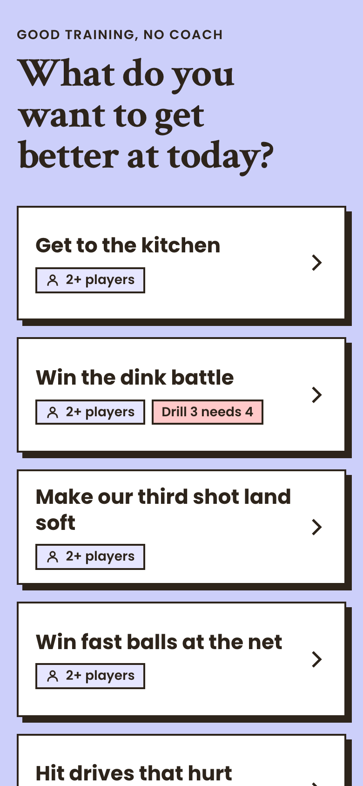
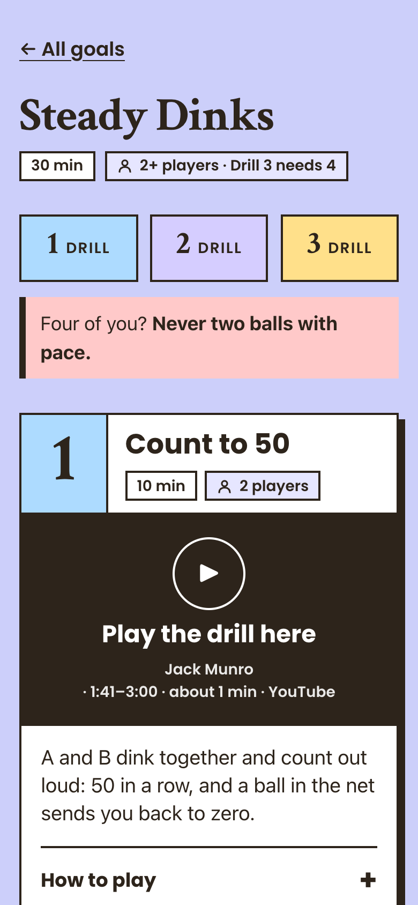

# Open Training

Pickleball sessions a group can run without a coach, one phone page per session:
https://open-training-site.vercel.app/

A free, non-commercial side project, built in my spare time by Volker Max Meyer, a product manager and service designer in Berlin, with Claude Code.

<p>
  
  
</p>

## The problem

I coach the advanced group in my pickleball club. I play along on one court, and a playing co-coach runs the second. Good drills are spread across hundreds of YouTube videos, most of them written for two players, and none of them is a plan a group can pull up on court. My assumption is that players who want to train without a coach mostly end up playing matches instead. The test under Status is there to check it.

## What it does

The start page asks what the group wants to get better at and offers nine goals, such as "Win the dink battle". Each goal opens a 30-minute session of three drills. A drill card shows one sentence, the part of a coach's video that demonstrates the drill (it plays inside the card after a tap), the rules, how to make it easier or harder, and what good looks like. A short form at the end asks whether the session worked without anyone explaining it.

## Where it comes from

This site is one of three interfaces on a private training system I built for my group.

```text
                  ┌──────────────── private ────────────────┐
 YouTube videos   │ Base: skill ladders, drills, weekly     │──▶ Coach: plan a session, plus
 + research on    │ themes, session frame, tactical and     │    a card for the co-coach
 teaching tactics │ mental cues, strategy playbook          │──▶ Open Training (this repo)
                  │                                         │──▶ Overview: what the base
                  │ Quality loop: guard scripts, feedback   │    contains, on one page
                  │ after every session                     │
                  └─────────────────────────────────────────┘
```

In November 2026 the base held 120 drills distilled from 205 reviewed videos, all in one shared vocabulary. The interfaces only read from it, so a new one is cheap to add, and the base was built with more of them in mind. It started as a Google Doc for my own training and grew into a system once I saw that other players could use the same material. The product view of the whole system is in [docs/prd.md](docs/prd.md), a snapshot from 6 November 2026.

## How I keep AI output honest

Claude Code wrote most of the code and much of the content. I set the goal, the rules and the priorities, and I approve or reject the work at fixed points. The checks themselves run by machine:

- 145 tests, among them a contrast test that fails below 7:1 and a test that keeps `DESIGN.md` and the CSS tokens in sync. They run before every publish commit and every push; red tests stop the release.
- A leak guard on every commit and push, so private notes and paths never reach this public repository (see below).
- A version number and a changelog line for every push, and a script that waits until Vercel serves the pushed commit.
- In the private base, three scripts check the vocabulary, the cue consistency and the links on every change. Every new drill's video link is checked against frames from the video before the drill is saved, because an audit in July 2026 found 26 of 100 links pointing to the wrong moment.

## Product decisions

- Cards follow the video, which is usually a pair drill, and groups of four get one warning line: never two balls with pace on one court. Translating every drill for four players had been the most expensive step, and it produced forms nobody had played.
- The video plays inside the card and stops where the drill ends, because court time is short.
- Taps only: no typing, no login, no cookies. Text and background keep at least 7:1 contrast so the page stays readable in the sun.
- The look is playful on purpose. The players should enjoy opening it, and a sober dashboard style was tried and dropped.
- How much a card should show is being tested with a version that has sliders. Testers set it up the way they want to read it between two drills and send a screenshot.
- The AI kept proposing test programmes sized for a startup. I cut the first test down to one question: is it needed?

## Status

Live since November 2026 with nine sessions. Groups beyond my own have not used it yet. A lean test through the club's coaches runs until January 2027: do groups play a session and come back to it?

## How the site works

```text
private notes ──publish script──▶ src/content/sessions/*.json ──git push──▶ Vercel build ──▶ static site
                 (validate, extract,            (leak guard runs on commit and push)
                  allowlist fields)
```

- **Astro, static output, no adapter.** Tailwind for styling. No external fonts or third-party scripts; a YouTube player
  (youtube-nocookie.com) loads only after a tap on a video.
- **Content is JSON, not copied notes.** `scripts/publish.ts` reads the sessions marked for publishing and builds
  each one from named fields only, so private notes and links never reach the repo. The site validates the JSON
  against `src/lib/session-schema.ts`.
- **Feedback** goes to a Tally form; the link carries the session slug as a hidden field. Answers stay in Tally.
  `scripts/canary.ts` is retired: it read a Google Sheet that is no longer connected.
- **Visitor statistics** come from Vercel Web Analytics: no cookies, no personal profiles.
- **Every deploy is checkable.** The site serves `version.txt` with the commit it was built from;
  `scripts/check-deploy.ts` polls it until the pushed commit is live.

## Publishing

```sh
npm run publish:site -- --dry-run   # show what would change
npm run publish:site                # validate, write JSON, guard, tests, commit, push
npx tsx scripts/check-deploy.ts     # wait until Vercel serves the new commit
```

The script aborts before writing anything if a source note is unreadable or a slug does not match its filename.
Removing a session that is already live needs `--allow-unpublish`. It commits only `src/content`, the bumped `src/version.json` and its `CHANGELOG.md` line.

## Version

The imprint shows the site version from `src/version.json`. It started at 1.000 and goes up by 0.001 with every push
to main, and every version gets one line in `CHANGELOG.md`. The publish script does both itself and names the sessions
it changed; a code change runs `npm run version:bump -- "what changed"` before its commit. To jump to another number,
write it into the file by hand and add its changelog line. The pre-push guard blocks a push to main whose version is
not higher than the live one or has no changelog line.

## Leak guard

`scripts/guard.ts` runs before every commit the publish script makes and, as a git pre-push hook, on every push. On
a push it scans every file of every commit being pushed, so something committed and deleted again is still caught.
It fails on:

- personal paths and private email addresses, including URL- and HTML-encoded forms
- notes markup that should never reach the site
- content files the publish script did not produce, or whose hash does not match its manifest
- session files that do not match the schema
- a push to main without a higher version or without its changelog line

After cloning, enable the hook once:

```sh
git config core.hooksPath .githooks
```

The hook lives in each clone, and `git push --no-verify` skips it. Both are accepted risks.

## Development

Node 24 (`.nvmrc`).

```sh
npm install
npm run dev     # local server
npm test        # vitest
npm run build
```

Local settings go in `.env.local` (gitignored), see `.env.example`.

## Credits

The drills are demonstrated in videos by these channels. Each card plays only the part that shows the drill; all
videos remain theirs.

- Backpaddle Pickleball
- Briones Pickleball Academy
- Building Pickleball
- Cam Luhring
- Catherine Parenteau
- Coach Jess | Athena Pickleball
- Cracked Pickleball
- Enhance Pickleball
- In2Pickle
- Jack Munro
- John Cincola Pickleball
- Pickleball Hub
- Pickleball Studio
- PickleballPlaybook - Austin Hardy
- Simone Jardim Pickleball
- ThatPickleballGuy - Kyle Koszuta
- Troy Akin Pickleball
- Walker Sisters Pickleball - Angie & Alex Walker
- Zane Navratil Pickleball

## License

The code is under the [MIT license](LICENSE). The session texts are not covered by it; ask before reusing them. The
videos belong to the channels listed above.

## Contact

Volker Max Meyer · [LinkedIn](https://www.linkedin.com/in/volkermaxmeyer/) · pickleballinberlin@gmail.com
